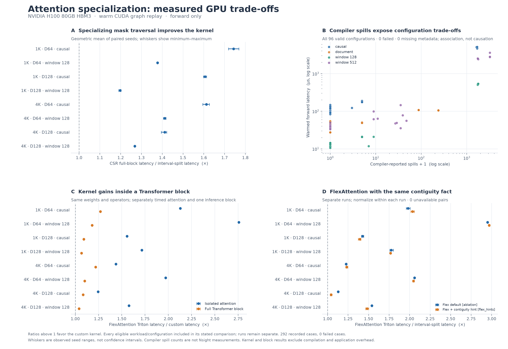

# Structured attention compilation and kernel search

This study lowers structured attention masks into two Triton execution paths:
a general sparse schedule and a specialized interval kernel. On an H100,
interval specialization was **1.443× faster than CSR traversal** and **1.661×
faster than FlexAttention’s Triton backend with the same contiguity fact**,
geometric means over eight causal/window workloads and three input seeds.

The extension also measures where the optimization stops helping. Kernel gains
became **1.129×** inside one inference Transformer block versus default
FlexAttention, and the causal-workload geometric mean remained slower than native
PyTorch SDPA. These are warmed CUDA-graph **forward** measurements, excluding
compilation, mask setup, Python dispatch, backward, and whole-model execution.



[Full experiment report](results/h100-20261104/analysis/REPORT.md) ·
[Machine-readable analysis](results/h100-20261104/analysis/SUMMARY.json) ·
[Experiment design and execution history](EXPERIMENTS.md)

## Results

The completed November 4, 2026 study contains **292/292 passing GPU cases** and
**86/86 passing requested FlexAttention comparisons**. All six stages ran on
an NVIDIA H100 80GB HBM3, using Python 3.12.10, PyTorch 2.11.0+cu130,
Triton 3.6.0, and CUDA 13.0.

The November 4 local correctness and orchestration suite passed all **47 tests**.

| Comparison | Geometric mean | Scope |
|---|---:|---|
| CSR full-block traversal / interval specialization | **1.443×** | 8 workloads × 3 seeds; paired fixed configurations |
| FlexAttention Triton with contiguity hint / interval specialization | **1.661×** | Separate follow-up run, 8 workloads × 3 seeds |
| Default FlexAttention / custom attention inside one full Transformer block | **1.129×** | 8 shapes, one input/weight seed; 1.041–1.271× range |
| Fixed default / transferred tuning configuration | 1.012× | 4 held-out workloads × 3 fresh seeds |
| Interval masked / interval split | 0.998× | Splitting boundary/interior loops alone gave no aggregate gain |
| Native causal SDPA / custom interval attention | 0.818× | 4 unrestricted causal workloads × 3 seeds in the ablation |
| Native causal SDPA / custom full Transformer block | 0.989× | 4 causal shapes, one input/weight seed |

Ratios above one favor the custom or specialized denominator. The main gain
comes from interval specialization relative to CSR; the results do not support
crediting loop splitting alone. The 96-configuration sweep also found latency
ranges up to **107.7×** within a workload, associated with high compiler-reported
spill counts. This is a resource association, not a profiler-based causal claim.
The report retains every measured configuration, regressions, and baseline mode.

## Implementation

- [Mask compiler](masks.py): causal, window, and same-document predicates become
  exact CSR tile schedules with full/partial classifications. Compilation avoids
  an allocated dense attention mask and supports repeated document labels.
- [Triton kernels](triton_attention.py): CSR traversal handles general supported
  masks; interval specialization derives key bounds analytically and avoids GPU
  CSR metadata. Both use online softmax and FP32 accumulators with FP16/BF16
  inputs. Full-block handling can be disabled for controlled ablations.
- [Benchmark harness](benchmark.py): independent math-SDPA correctness checks,
  native causal SDPA, independently constructed FlexAttention masks, raw CUDA
  graph samples, and compiler register/spill/shared-memory metadata.
- [Configuration search](search.py): correctness-gated random/evolutionary search
  over 24 tile/warp/stage configurations. The completed study compares search
  policies by **offline replay of GPU-measured tables**, not repeated online GPU
  searches. [GPU search](gpu_search.py) is also available for live experiments.
- [Block benchmark](block_benchmark.py): attention substitutions inside the same
  BF16 block, including layer norms, projections, residuals, and GELU MLP.
  Configuration selection is frozen before evaluating the block.

## Evidence and reproduction

The [result directory](results/h100-20261104) contains each stage’s raw case JSON,
timing samples, summaries, environment, and launch settings. The two follow-up
stages also preserve source snapshots; earlier stages retain source hashes.
Launch manifests and summaries record source SHA-256 values; generated-kernel
metadata records IR/PTX/cubin hashes. Baseline source case IDs identify reused
measurements. Default and hinted FlexAttention runs remain separate.
The [initial diagnostic ablation](results/diagnostics/attention-ablation-20261104a)
is preserved separately and excluded from the final 292-case results.

From the repository root, regenerate the report and figure without a GPU:

```bash
python -m attention_lab.analyze_study --input attention_lab/results/h100-20261104 --output-dir attention_lab/results/h100-20261104/analysis
python -m attention_lab.plot_results --input attention_lab/results/h100-20261104 --output attention_lab/results/h100-20261104/gpu_tradeoffs.png
```

Run CPU checks with PyTorch installed:

```bash
python -m unittest discover -s attention_lab -p 'test_*.py' -v
python -m attention_lab.validate --output /tmp/attention_cpu_validation.json
```

The preserved [CPU validation](results/cpu_validation.json) records 440 mask
cases and 24 FP64 output/gradient comparisons with errors below 2e-15. Additional
interval tests cover 550 CSR-classification and 384 scalar-semantics cases.
Those preserved CPU gradient checks concern the reference interpreter; the
November 4 measurements cover forward execution only.

## Training and CUDA decode extensions

Two additional implementations are available separately from the measured
November 4 forward study:

- [Trainable structured attention](BACKWARD.md) saves row log-sum-exp and uses
  query-owned dQ and transposed-CSR key-owned dK/dV kernels. Its study checks
  outputs, all three input gradients, and a full Transformer optimizer step
  with observable FP32 master-weight updates.
- [CUDA split-KV decoding](cuda_decode/README.md) shares KV tiles across grouped
  query heads and merges independent context splits with stable FP32 softmax
  statistics. Its study compares unsplit/split CUDA, Flash SDPA, and
  FlexDecoding with identical single-token semantics.

The completed [November 5 extension report](results/h100-extensions-20261105/analysis/report.md)
records **582/582 CUDA decode checks** and **15/15 training-study cases** passing
on H100. Tile-level softmax reduced decode latency by **16.1% geometrically**
versus the token-level version across 180 matched split/shape/seed pairs. Native
Flash SDPA remained faster than the custom decoder in all 30 workload/seed cases.
The trainable path achieved **1.37–1.40×** forward-plus-backward speedup versus
FlexAttention Triton on two sliding-window workloads; causal and packed-document
workloads did not show that gain. Backward alone remained slower in this sweep.

The complete local suite has 56 passing CPU tests and two CUDA-only tests; both
CUDA tests passed in the remote training study. The [bounded launcher](run_extensions.py)
snapshots source and preserves raw correctness records, timing samples, failures,
and environment details. Training graph timing uses the same explicit stream
for retained forward graphs and backward capture. Full optimizer-step comparisons
use matched eager timing, including host submission gaps. Flex buffer donation
is disabled for retained backward, and this setting is recorded.

Reproduce with an authenticated Modal profile (each execution uses one H100):

```bash
uv run --no-project --python 3.12 --with 'modal[api-proxy-support]==1.5.1' python -m attention_lab.run_extensions --stage cuda-study --time-budget-seconds 600 --execute
uv run --no-project --python 3.12 --with 'modal[api-proxy-support]==1.5.1' python -m attention_lab.run_extensions --stage backward-study --time-budget-seconds 600 --execute
```

Omit `--execute` to inspect the source manifest and resource estimate without
provisioning a GPU. The study does not provide a billing cap. Initial failures
and the corrected Flex-backend label are preserved as diagnostics and excluded
from final performance aggregates.

To run the six-stage campaign with an authenticated Modal profile:

```bash
uv run --no-project --python 3.12 --with 'modal[api-proxy-support]==1.5.1' python -m attention_lab.run_campaign --gpu H100
uv run --no-project --python 3.12 --with 'modal[api-proxy-support]==1.5.1' python -m attention_lab.run_campaign --gpu H100 --execute
```

The first command is a dry run. Execution uses one GPU at a time, explicit
timeouts, no automatic retries, and failure gates. At November 4 rates, the
requested-resource estimate if all six stages reach their timeouts is **$5.4188**.
This is not an actual charge or billing cap; builds, startup, excess CPU/RAM,
storage, and other applications are excluded. New runs are saved under `runs/`
and the `attention-kernel-study` Modal volume.

## Scope

The November 4 study is an engineering extension of established attention techniques. It covers
contiguous square self-attention, D64/128, one shared mask across batches/heads,
and FP16/BF16 forward execution. Document changes require recompilation. It does
not measure GPU backward, arbitrary mask expressions, an LLVM/MLIR pass,
an LLM optimization agent, or a learned RL policy. The existing distributed
training and earlier FlashAttention-backward projects are separate work.

## Primary references

- [FlashAttention-2](https://tridao.me/publications/flash2/flash2.pdf) and the
  [Triton fused-attention tutorial](https://triton-lang.org/main/getting-started/tutorials/06-fused-attention.html): tiled attention and online softmax.
- [NVIDIA’s attention optimization study](https://developer.nvidia.com/blog/tuning-flash-attention-for-peak-performance-in-nvidia-cuda-tile/): loop splitting, tile sizes, and resource pressure.
- [FlexAttention + FlashAttention-4](https://pytorch.org/blog/flexattention-flashattention-4-fast-and-flexible/): mask lowering and sparse execution. Our measured baseline is **Triton, not FA4**.
- [KernelFoundry](https://proceedings.mlr.press/v306/wiedemann26a.html): evolutionary optimization; our finite configuration search does not reproduce its LLM/MAP-Elites method.
