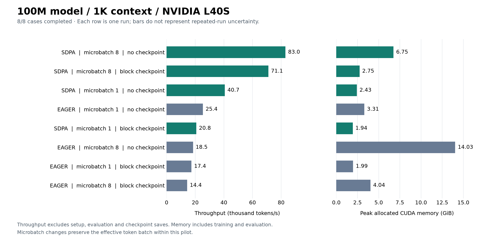

# First GPU pilot: 100M parameters, 1K context

November 1, 2026. Run `20261101T115005Z-e1fdfb9a`.

All eight configurations completed on one NVIDIA L40S. This is the first hardware
screen, with one run per configuration; it is not a convergence or quality-equivalence
study. The measured differences below describe this workload and invocation.

## Workload and checks

- Custom 100,313,856-parameter MHA decoder, 12 layers, width 768, 12 heads,
  head dimension 64, feed-forward width 2,048, vocabulary 10,000; random initialization.
- TinyStories token arrays; context 1,024; BF16 autocast with FP32 parameters,
  optimizer state and loss; effective batch 8 sequences / 8,192 tokens per update.
- Seed 1337, 30 optimizer updates / 245,760 tokens per case. Timing excludes the
  first five updates and includes the remaining 25. Validation uses 4,096 fixed tokens.
- All eight cases have matching dataset/tokenizer and ordered training-batch hashes;
  the aggregate comparability check passed. There were no failed or OOM cases.
- Native CUDA/BF16 preflight and the pytest invocation succeeded: the launcher gates
  training on their zero exit codes, and its final status is `finished`. The exact
  pytest pass/skip count is not in the returned summaries; `tests.log` remains remote.



## Measurements

`Microbatch / accumulation` describes one optimizer update. GiB means 2^30 bytes.

| Attention | Checkpoint | Microbatch / accumulation | Median step (ms) | p90 step (ms) | Tokens/s | Peak allocated (GiB) | Peak reserved (GiB) | Validation loss |
| --- | --- | ---: | ---: | ---: | ---: | ---: | ---: | ---: |
| SDPA | none | 8 / 1 | 98.69 | 98.95 | 83,015 | 6.75 | 6.94 | 4.880787 |
| SDPA | block | 8 / 1 | 115.20 | 115.49 | 71,084 | 2.75 | 3.04 | 4.880907 |
| SDPA | none | 1 / 8 | 199.69 | 208.65 | 40,653 | 2.43 | 2.44 | 4.880862 |
| EAGER | none | 1 / 8 | 321.43 | 325.25 | 25,416 | 3.31 | 3.42 | 4.880975 |
| SDPA | block | 1 / 8 | 391.85 | 403.96 | 20,756 | 1.94 | 2.06 | 4.880972 |
| EAGER | none | 8 / 1 | 443.96 | 444.27 | 18,452 | 14.03 | 14.50 | 4.880942 |
| EAGER | block | 1 / 8 | 463.94 | 485.50 | 17,381 | 1.99 | 2.12 | 4.880975 |
| EAGER | block | 8 / 1 | 569.61 | 569.91 | 14,381 | 4.04 | 4.28 | 4.880942 |

Throughput is measured tokens divided by the sum of measured step durations; it is
not calculated as tokens divided by the median duration. Each step includes batch
sampling/transfers, forward/backward, accumulation, clipping, optimizer work and
scalar diagnostics, with CUDA synchronization. It excludes setup, evaluation and
checkpoint saves. Memory peaks include training and evaluation after model setup,
including persistent state; allocated memory is not total GPU process memory.

## Observations worth testing further

1. **Attention changes the microbatch ranking.** Without checkpointing, increasing
   microbatch 1 to 8 increased SDPA throughput 2.042x,
   but decreased eager throughput 27.4%.
   The underlying kernel and hardware cause has not been profiled.
2. **Checkpointing has a much better trade-off at microbatch 8 here.** For SDPA at
   microbatch 8, peak allocated memory fell from 6.75
   to 2.75 GiB
   (59.3% less),
   while median step time increased 16.7%.
   At microbatch 1, memory fell only
   20.2% and median step time
   increased 96.2%.
3. **Use the strongest observed baseline.** SDPA/no-checkpoint/microbatch 8 achieved
   4.499x eager throughput at the *same* microbatch 8,
   using 51.9% less allocated memory.
   Against the *fastest observed eager configuration* (microbatch 1), SDPA achieved
   3.266x throughput while using
   2.039x allocated memory.
   These are measured pilot ratios, not general model speedup claims.
4. **Short-job overhead changes the practical gain.** The same-microbatch-8
   comparison improved complete case subprocess time only
   2.166x, versus the
   4.499x steady-state throughput ratio.
   Setup, imports, evaluation and checkpointing matter in these short runs.
5. **There are several useful memory/speed choices.** All four SDPA cases are on
   this pilot's observed memory/throughput frontier. SDPA/block/microbatch 8 is
   1.749x as fast as
   SDPA/no-checkpoint/microbatch 1 for 13.0%
   more allocated memory. Every measured eager case is dominated by a measured
   SDPA case on these two metrics.

Validation loss ranged from 4.880787 to 4.880975, an absolute spread of
0.00018716. This is a short-run numerical sanity check. Thirty updates, one seed
and a small validation sample do not establish equal final accuracy, convergence,
long-run stability or time/cost to target quality. The 25 timed steps are not 25
independent experiment repetitions. SDPA selected its backend automatically; no
specific FlashAttention kernel has been verified.

## Time, cost and evidence

The remote function took **144.113 seconds**, including preflight,
tests and orchestration. The sum of the eight case subprocess times was
125.065 seconds. The function duration excludes
client upload and cloud image-build time. Actual provider charges have not been
retrieved; these timings are not a bill or proof of a dollar saving.

The three JSON files in this directory are unchanged copies of the locally returned
launch manifest, launch summary and aggregate. Their SHA-256 hashes are recorded in
`input-sha256.json`. The launch manifest describes uploaded inputs and direct
package pins; a full transitive dependency lock is not yet captured.

Full per-step metrics, resolved plan/source metadata, test logs and checkpoints
remain in Modal Volume `systems-for-llms-results`, under
`20261101T115005Z-e1fdfb9a/`. Those full remote artifacts have not yet been downloaded
for an independent audit. [Cloud run](https://modal.com/apps/sumanthsetty/main/ap-qNMQZmYlpxXldfmEGz7DaH).

To reproduce the figure, with matplotlib installed (generated using 3.11.0):

```sh
python scripts/plot_pilot.py results/2026-11-01-100m-1k \
  --title "100M model / 1K context / NVIDIA L40S"
```

## Next experiment

The planned 100M / 4K screen subsequently completed; its
[report](../2026-11-01-100m-4k/README.md) compares the speed and memory trade-offs at
the same 8,192 tokens/update. Continue with the smaller and larger model controls
and inspect billed usage before expanding the screen. Compare configurations
within each context; do not pool the 1K/4K validation losses. Collect separate
profiler traces and repeat central comparisons on fresh paired seeds 2027, 2028
and 2029 before longer quality runs.
