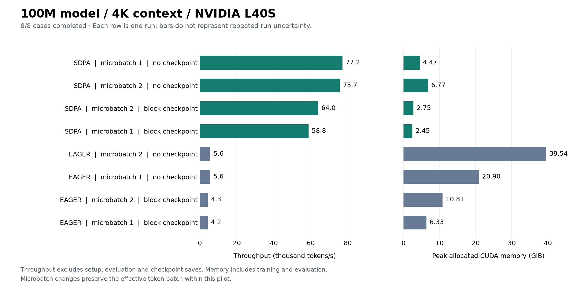

# GPU pilot: 100M parameters, 4K context

November 1, 2026. Run `20261101T123821Z-74cc9b01`.

All eight configurations completed on one NVIDIA L40S, with passing comparability
checks and no OOMs. At microbatch 2 without checkpointing, SDPA measured 13.531x
eager throughput while using 82.9% less peak allocated memory. This is a one-seed
hardware screen, with one run per configuration; it does not establish convergence,
quality equivalence or cost to a quality target.

## Workload and checks

- Custom 100,313,856-parameter MHA decoder: 12 layers, width 768, 12 heads,
  head dimension 64, feed-forward width 2,048, vocabulary 10,000; random initialization.
- TinyStories token arrays, context 4,096; BF16 autocast with FP32 parameters,
  optimizer state and loss. Effective batch is 2 sequences / 8,192 tokens per update.
- Seed 1337, 30 optimizer updates / 245,760 tokens per case. The first five updates
  are excluded from timing; 25 measured updates remain. Validation uses one fixed
  4,096-token window, held equal across cases in this workload.
- Dataset/tokenizer hashes and ordered training-batch hashes match across all eight
  cases. Every case has the expected measured-step count and finite reported losses.
- Native CUDA/BF16 preflight and the pytest invocation passed their exit-code gates.
  Exact pytest pass/skip counts and full per-step logs have not yet been retrieved.



## Measurements

`Microbatch / accumulation` describes one optimizer update. GiB means 2^30 bytes.

| Attention | Checkpoint | Microbatch / accumulation | Median step (ms) | p90 step (ms) | Tokens/s | Peak allocated (GiB) | Peak reserved (GiB) | Validation loss |
| --- | --- | ---: | ---: | ---: | ---: | ---: | ---: | ---: |
| SDPA | none | 1 / 2 | 106.13 | 106.33 | 77,191 | 4.47 | 4.69 | 5.077971 |
| SDPA | none | 2 / 1 | 108.20 | 108.39 | 75,694 | 6.77 | 6.96 | 5.077506 |
| SDPA | block | 2 / 1 | 127.94 | 128.39 | 63,979 | 2.75 | 3.05 | 5.077582 |
| SDPA | block | 1 / 2 | 136.38 | 137.86 | 58,794 | 2.45 | 2.49 | 5.077971 |
| EAGER | none | 2 / 1 | 1464.43 | 1465.26 | 5,594 | 39.54 | 40.39 | 5.077691 |
| EAGER | none | 1 / 2 | 1472.19 | 1472.74 | 5,564 | 20.90 | 21.56 | 5.078071 |
| EAGER | block | 2 / 1 | 1914.04 | 1914.74 | 4,280 | 10.81 | 11.05 | 5.077691 |
| EAGER | block | 1 / 2 | 1930.25 | 1931.01 | 4,244 | 6.33 | 6.52 | 5.078071 |

Throughput is measured tokens divided by summed measured step durations, not by
the median duration. Steps include batch sampling/transfers, forward/backward,
accumulation, recomputation, clipping, optimizer work and scalar diagnostics, with
CUDA synchronization. Setup, evaluation and checkpoint saves are excluded from
step timing. Memory peaks cover training and evaluation after model setup, including
persistent state; allocated memory is not total GPU process memory.

## Observations

1. **The attention gap is larger at long context.** At microbatch 2 without
   checkpointing, SDPA measured 75,694 tokens/s and 6.77 GiB versus eager's
   5,594 tokens/s and 39.54 GiB. The steady-state throughput ratio is 13.531x;
   complete case subprocess time improved 5.082x. Both scopes matter for short jobs.
2. **SDPA microbatch 1 is a useful candidate at 4K.** Without checkpointing it
   measured 77,191 tokens/s and 4.47 GiB: 2.0% more throughput and 34.0% less allocated
   memory than microbatch 2. The small speed difference needs repeated invocations.
   At 1K, the largest tested microbatch was substantially faster; the observed
   ranking does not transfer unchanged to this workload.
3. **Checkpointing still offers a memory trade-off.** At SDPA microbatch 2, block
   checkpointing saved 59.3% allocated memory with an 18.2% increase in median step
   time. Against the strongest observed SDPA baseline, uncheckpointed microbatch 1,
   checkpointed microbatch 2 saved 38.4% memory with a 20.6% median-step penalty
   (17.1% less throughput). Use the latter comparison for practical policy selection.
4. **Three SDPA policies remain on the observed memory/throughput frontier:**
   no checkpoint/microbatch 1, block/microbatch 2 and block/microbatch 1. Every eager
   case and uncheckpointed SDPA/microbatch 2 is dominated in this invocation. The
   small gap between uncheckpointed SDPA cases makes that part of the frontier
   provisional until repeated.

Within this 4K workload, validation loss ranged from 5.077506 to 5.078071,
an absolute spread of 0.00056458. These finite, nearby values are a numerical
sanity check. One validation window, 30 updates and one seed do not establish
quality equivalence, long-run stability or time to target. The 25 timed steps
are not independent experiment repetitions. SDPA chose its backend automatically;
no specific FlashAttention kernel has been verified.

## Comparison with the 1K screen

The [1K report](../2026-11-01-100m-1k/README.md) uses the same model family member
and 8,192 tokens/update. The table below compares microbatch 8 at 1K with
microbatch 2 at 4K, both without accumulation: **8,192 tokens per microbatch**.

| Policy | 1K median step (ms) | 4K median step (ms) | 4K / 1K step time | 1K allocated (GiB) | 4K allocated (GiB) |
| --- | ---: | ---: | ---: | ---: | ---: |
| Eager, no checkpoint | 443.96 | 1464.43 | 3.299x | 14.03 | 39.54 |
| Eager, block checkpoint | 569.61 | 1914.04 | 3.360x | 4.04 | 10.81 |
| SDPA, no checkpoint | 98.69 | 108.20 | 1.096x | 6.75 | 6.77 |
| SDPA, block checkpoint | 115.20 | 127.94 | 1.111x | 2.75 | 2.75 |

Eager's uncheckpointed allocated peak grew 2.818x; SDPA's grew 0.3%. This is
consistent with the different storage costs of explicit attention matrices and
optimized attention, but component timings and the dispatched kernel have not
been profiled. These are two separate cloud invocations. Context length, sequence
count and sampled windows change together; fixed token count does not make the
batches identical. The table describes related workload measurements rather than
a fully isolated causal estimate. Do not compare or pool validation losses across
the two context lengths.

## Time, cost and evidence

Remote function time was **291.461 seconds**, including preflight, tests and
orchestration. Case subprocess durations sum to **277.118 seconds**. Function time
excludes client upload and cloud image builds. Provider charges have not been
retrieved; these durations are not a bill or evidence of dollar savings.

`launch.json`, `launch-summary.json` and `aggregate.json` are unchanged copies of
the locally returned files; `input-sha256.json` records their SHA-256 hashes.
Full per-step metrics, resolved plan/source metadata, test logs and checkpoints
remain in Modal Volume `systems-for-llms-results`, under
`20261101T123821Z-74cc9b01/`. They have not yet been downloaded for independent
audit. [Cloud run](https://modal.com/apps/sumanthsetty/main/ap-SBzV7XhOJCbN9hcrYO5Kw9).

Reproduce the figure with matplotlib installed (generated using 3.11.0):

```sh
python scripts/plot_pilot.py results/2026-11-01-100m-4k \
  --title "100M model / 4K context / NVIDIA L40S"
```

## Next experiment

The two 100M screens now cover 16 completed cases. Continue the planned model-size
controls, retain OOM/timeout outcomes, and inspect billed usage while preserving
the reserve. Collect separate profiler traces to explain the large attention gap
and repeat central comparisons on fresh paired seeds 2027, 2028 and 2029 before
longer quality runs. Tensor/pipeline parallelism remains a conditional extension
to the later distributed stage.
