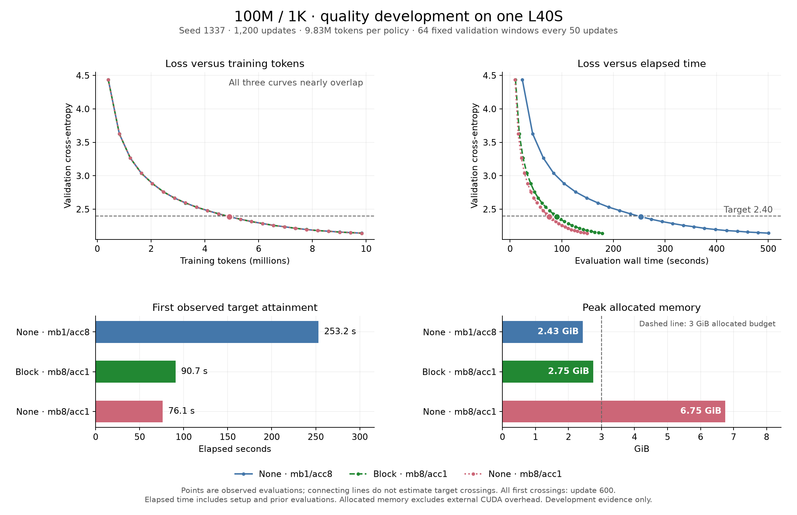

# 100M/1K quality development

Three SDPA policies completed 1,200 updates each on an NVIDIA L40S, with seed
1337, 8,192 tokens per update and 9,830,400 training tokens per policy. All cases
passed ordered-batch comparability. The remote test log records **168 passed**.
These are development measurements; fresh-seed confirmation has not yet run.



| SDPA policy | Peak allocated / reserved GiB | Tokens/s | First time to loss ≤2.40 | Final validation loss |
| --- | ---: | ---: | ---: | ---: |
| No checkpoint, mb1 / accumulation 8 | 2.429 / 2.441 | 20,863 | 253.167 s | 2.142283164 |
| Block checkpoint, mb8 / accumulation 1 | 2.745 / 3.041 | 65,413 | 90.741 s | 2.142018253 |
| No checkpoint, mb8 / accumulation 1 | 6.751 / 6.938 | 81,995 | 76.114 s | 2.141623070 |

All three first reached the target at the evaluation after update **600**,
corresponding to **4,915,200 training tokens**. No earlier evaluation reached it.
The final loss spread is 0.000660094; a single development seed does not establish
quality equivalence or downstream task accuracy.

## Target selection

The rule was recorded in the [prelaunch campaign](campaign.json): take the largest
of the three validation losses at update 600 and round upward to a multiple of
0.05. The losses were 2.3878817595541477 (none/mb1), 2.3883473575115204 (block/mb8),
and 2.3875473272055387 (none/mb8). Decimal arithmetic gives:

```text
ceil(2.3883473575115204 / 0.05) × 0.05 = 2.40
```

The [frozen target](frozen-target.json) records the target, protocol, input hashes
and source/data identities. Confirmation must validate that file before launching
seeds 2027, 2028 and 2029; the development seed is not reused for confirmation.

## Interpretation

Against the unrestricted no-checkpoint mb8 baseline, block checkpointing used
**59.33% less allocated memory**, while taking **19.22% longer to the target**.
Its final validation loss was higher by 0.000395183.

Against the selected lower-memory no-checkpoint mb1 baseline, the block-mb8
candidate reached the target **2.790× faster**, with **13.03% more allocated
memory**. Both satisfy the illustrative 3 GiB *allocated-memory* budget.
Block-mb8 reserved 3.041 GiB, so this does not demonstrate fitting a physical
3 GiB GPU; CUDA/context overhead is also outside allocated tensor memory.
Intermediate microbatches were not exhaustively searched.

The lower-memory baseline's throughput was **48.68% below its earlier 30-update
pilot** (20,863 versus 40,653 tokens/s). It was already slow in updates 6–30
(21,147 tokens/s); subsequent windows stayed around 20.4–21.7k tokens/s, without
a monotonic late-run decline. The cause is unproven. The 2.790× target-time gain
is a development observation that needs fresh runs and separate CPU/GPU profiling.
The unrestricted mb8 baseline was about 1.2% below its pilot throughput.

## Protocol and measurement scope

- Model: 100,313,856 parameters, 1,024-token context, vocabulary 10,000, 12 layers,
  width 768, 12 attention heads, feed-forward width 2,048.
- Identical model initialization and ordered training batches across policies.
  All 1,200 update hashes, learning-rate schedules and token counts match.
- BF16 autocast with FP32 parameters and loss; AdamW learning rate 0.0003,
  minimum 0.00003, 50-update warmup and cosine schedule through update 1,200.
- Each evaluation uses the same 64 fixed windows, batch 1: 65,536 validation
  tokens every 50 updates, for 24 evaluations. A final checkpoint follows the
  final evaluation. All raw numeric metrics are finite.
- Target time is the first observed evaluation's `wall_seconds`; no interpolation.
  It includes runner setup and preceding evaluations/checkpoints, and excludes
  Python interpreter/import startup. Whole subprocess times were 504.65 s, 183.03 s
  and 153.06 s for none/mb1, block/mb8 and none/mb8 respectively.
- Throughput excludes the first five training updates and excludes evaluation and
  checkpoint time. Allocated/reserved peaks cover training and evaluation after
  model initialization. Remote function time was 859.133 s, not a billed total.
- Source/data/package identities match. Content source SHA-256 is
  `35dfb435eb9a210c8b6984be60c22c15f1e78b08508ec771f1cbbaaf41109136`.
  Remote Git commit/status metadata is null; provenance is based on content hashes.
  SDPA dispatch is automatic; a specific fused attention kernel has not been identified.

## Evidence and reproduction

Unchanged returned files: [launch](launch.json), [launch summary](launch-summary.json),
[aggregate](aggregate.json), and [full evidence](evidence.json). The latter contains
the test log, metadata and full per-step metrics. Evidence SHA-256:
`a7fb670ff52d521cee8a7377055dd0be0d8d2b769a9f37a3d0cc9cf0ae3baab7`.
The frozen target hashes these inputs and the prelaunch campaign.

Run `study-20261101T132912Z-100m-1k-quality-dev`:
[Modal app](https://modal.com/apps/sumanthsetty/main/ap-NUsDAOut5Cn4j9fMe8qg6H).

Rebuild the PNG and SVG from the repository root with a Python environment that
has Matplotlib installed:

```sh
MPLCONFIGDIR=/tmp/llmlab-matplotlib python3 scripts/plot_quality.py \
  results/2026-11-01-100m-quality-dev/evidence.json --target 2.40 \
  --output-dir results/2026-11-01-100m-quality-dev
```

The [study protocol](../../docs/quality-study.md) defines the next confirmation
stage and the limitations of three-seed descriptive comparisons.
