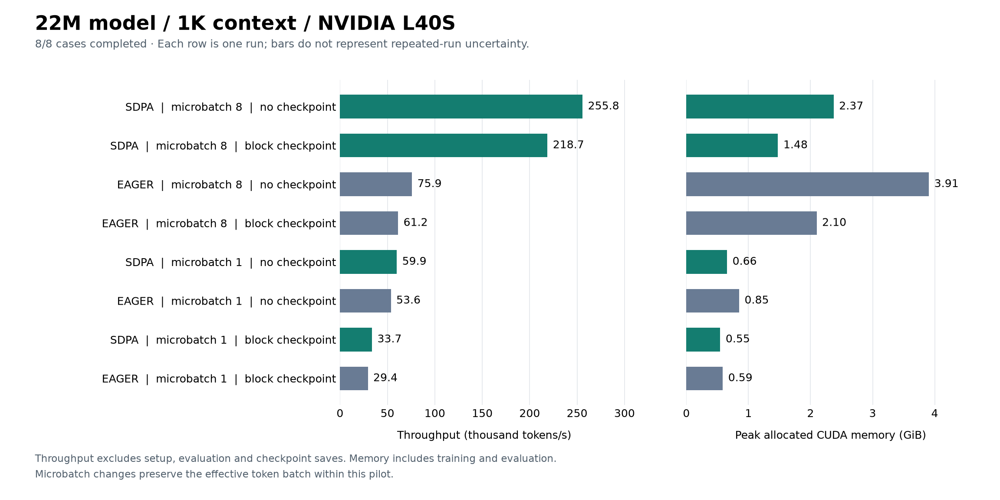

# GPU pilot: 22M parameters, 1K context

November 1, 2026. Run `20261101T131029Z-aeb8becf`.

All eight configurations completed on one NVIDIA L40S with passing comparability
checks and no OOMs. SDPA without checkpointing at microbatch 8 measured 255,753
tokens/s, 3.371x the fastest observed eager configuration, with 39.3% less peak
allocated memory. These are single-seed screening measurements, not convergence
or quality-equivalence results.

## Workload and checks

- Custom 22,696,448-parameter MHA decoder: four layers, width 512, eight heads,
  head dimension 64, feed-forward width 1,344, vocabulary 10,000; random initialization.
- TinyStories token arrays, context 1,024; BF16 autocast with FP32 parameters,
  optimizer state and loss. Effective batch is 8 sequences / 8,192 tokens per update.
- Seed 1337, 30 optimizer updates / 245,760 tokens per case. The first five updates
  are excluded from timing; 25 measured updates remain. Validation uses four fixed
  1,024-token windows, held equal across cases.
- All eight cases have matching dataset/tokenizer and ordered training-batch hashes,
  the expected measured-step count and finite reported losses.
- Native CUDA/BF16 preflight and the pytest invocation passed their exit-code gates.
  Exact pytest counts and full per-step logs have not yet been retrieved.
- This controlled-family model has eight attention heads. The older 22.7M
  integration workload with 16 heads is separate and is not pooled into this report.



## Measurements

`Microbatch / accumulation` describes one optimizer update. GiB means 2^30 bytes.

| Attention | Checkpoint | Microbatch / accumulation | Median step (ms) | p90 step (ms) | Tokens/s | Peak allocated (GiB) | Peak reserved (GiB) | Validation loss |
| --- | --- | ---: | ---: | ---: | ---: | ---: | ---: | ---: |
| SDPA | none | 8 / 1 | 32.07 | 32.50 | 255,753 | 2.37 | 2.67 | 6.017300 |
| SDPA | block | 8 / 1 | 37.32 | 37.98 | 218,727 | 1.48 | 1.76 | 6.017360 |
| EAGER | none | 8 / 1 | 107.70 | 109.00 | 75,871 | 3.91 | 4.48 | 6.017367 |
| EAGER | block | 8 / 1 | 133.41 | 134.78 | 61,215 | 2.10 | 2.42 | 6.017367 |
| SDPA | none | 1 / 8 | 136.76 | 143.05 | 59,862 | 0.66 | 0.68 | 6.017397 |
| EAGER | none | 1 / 8 | 152.15 | 155.17 | 53,630 | 0.85 | 0.90 | 6.017408 |
| SDPA | block | 1 / 8 | 238.91 | 250.50 | 33,704 | 0.55 | 0.59 | 6.017333 |
| EAGER | block | 1 / 8 | 278.03 | 288.11 | 29,385 | 0.59 | 0.69 | 6.017408 |

Throughput is measured tokens divided by summed measured step durations, not by
the median duration. Steps include sampling/transfers, forward/backward,
accumulation, recomputation, clipping, optimizer work and scalar diagnostics with
CUDA synchronization. Setup, evaluation and checkpoint saves are excluded from
step timing. Memory peaks cover training and evaluation after model setup,
including persistent state; allocated memory is not total GPU process memory.

## Observations

1. **The largest tested microbatch helps both attention implementations here.**
   Without checkpointing, moving microbatch 1 to 8 increased SDPA throughput
   4.272x and eager throughput 1.415x. The eager preference differs from the
   100M/1K result, where microbatch 8 was slower than microbatch 1.
2. **Checkpointing at SDPA microbatch 8 saves memory at moderate step cost.**
   Allocated memory fell from 2.37 to 1.48 GiB, a 37.8% reduction, while median
   step time increased 16.3% and throughput decreased 14.5%. At microbatch 1,
   checkpointing saved only 16.8% memory with a 74.7% median-step increase.
3. **Short-job overhead greatly reduces the whole-case speedup.** SDPA versus
   eager at microbatch 8 improved steady-state throughput 3.371x, but complete
   case subprocess time improved only 1.367x. Import, setup and checkpoint costs
   matter for these short runs.
4. **Every measured eager case is dominated by an SDPA case** on throughput
   and peak allocated memory. All four SDPA cases are on the observed frontier;
   the most suitable choice depends on the memory budget.

Validation loss ranged from 6.017300 to 6.017408, an absolute spread of
0.00010860. These finite, nearby values are a short-run numerical sanity check.
Thirty updates and one seed do not establish final accuracy, long-run stability
or time/cost to target. The 25 timed steps are not independent experiment
repetitions. The actual SDPA backend has not been identified with a profiler.

## Comparison with the 100M/1K screen

Both workloads use head dimension 64, context 1,024, the same data/tokenizer and
ordered training-batch hashes, and 8,192 tokens per update. Width, depth and head
count differ, and the jobs ran in separate cloud invocations. The comparison
shows transfer across two model configurations; it does not isolate parameter
count as a causal factor or establish a scaling law.

| Measurement | 22.7M / 1K | 100.3M / 1K |
| --- | ---: | ---: |
| Fastest observed SDPA throughput (tokens/s) | 255,753 | 83,015 |
| Fastest observed SDPA microbatch | 8 | 8 |
| Fastest observed eager microbatch | 8 | 1 |
| Eager throughput change, microbatch 1 to 8 | +41.5% | -27.4% |
| SDPA mb8 checkpoint memory reduction | 37.8% | 59.3% |
| SDPA mb8 checkpoint median-step increase | 16.3% | 16.7% |

The changing eager microbatch preference is a useful result to confirm across
seeds and explain with separate profiler traces. Losses after 30 updates are not
a sufficient basis for model selection or claims about training efficiency.
See the [100M/1K report](../2026-11-01-100m-1k/README.md) for its measurements.

## Time and evidence

Remote function time was **101.061 seconds**, including preflight, tests and
orchestration. Case subprocess durations sum to **83.276 seconds**. Function
time excludes client upload and cloud image builds. This run is not present in
the retrieved usage snapshot; its actual billed amount remains unverified.

`launch.json`, `launch-summary.json` and `aggregate.json` are unchanged copies of
the returned local files. `input-sha256.json` records their SHA-256 hashes.
Full per-step metrics, resolved source/plan metadata, test logs and checkpoints
remain in Modal Volume `systems-for-llms-results`, under
`20261101T131029Z-aeb8becf/`. They have not yet been downloaded for independent
audit. The launcher recorded PyTorch 2.11.0 and one NVIDIA L40S.

Reproduce the figure with matplotlib installed (generated using 3.11.0):

```sh
python scripts/plot_pilot.py results/2026-11-01-22m-1k \
  --title "22M model / 1K context / NVIDIA L40S"
```

## Next experiment

The initial three workloads now cover 24 completed cases. Finish 22M/4K and the
324M controls, repeat central policy comparisons on fresh paired seeds, and
measure longer learning curves against tokens and elapsed time. Preserve OOMs
and timeouts as different outcomes and use measured provider usage for cost
accounting. Distributed extensions remain a later stage of the project.
