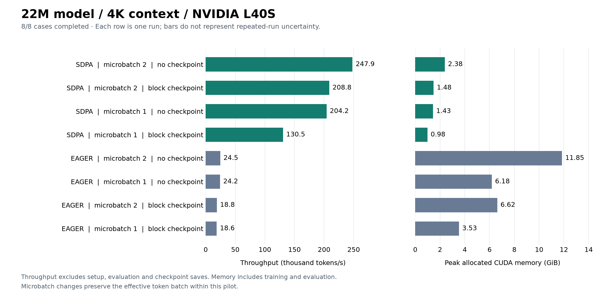

# GPU screen: 22M parameters, 4K context

November 1, 2026. Run `study-20261101T132912Z-22m-4k-screen`.

All eight configurations completed with passing comparability checks. At microbatch 2 without checkpointing, SDPA measured **10.112x eager throughput** with **79.9% less peak allocated memory**.
This is one invocation per configuration at one seed, not a convergence or quality-equivalence experiment.

## Workload and evidence checks

- Custom 22,696,448-parameter MHA decoder: 4 layers, width 512, 8 heads, head dimension 64, feed-forward width 1,344, untied 10,000-token vocabulary/output head, random initialization.
- TinyStories arrays; context 4,096; BF16 autocast with FP32 parameters, optimizer state and loss. Effective batch 2 sequences / 8,192 tokens per update.
- Seed 1337; each completed case trained for 30 updates / 245,760 tokens. Excluding the first five updates leaves 25 timed updates. Validation uses 1 fixed batch(es) of one sequence, totaling 4,096 tokens.
- All 8 completed cases have matching dataset/tokenizer identities and ordered training-batch hashes, expected measured-step counts and finite final losses. This does not assert identical floating-point updates.
- Native CUDA/BF16 preflight passed. Captured test result: **168 passed in 8.46s**. Full returned evidence has no missing files, errors or truncated logs.
- GPU: NVIDIA L40S, reported total memory **47,695,921,152 bytes (44.42 GiB)**. PyTorch 2.11.0; one GPU.



## Measurements

All eight attempted cases are retained below. GiB means 2^30 bytes. Empty metrics indicate no valid completed measurement; they are not zero throughput or zero memory.

| Attention | Checkpoint | Microbatch / accumulation | Status | Median step (ms) | p90 step (ms) | Tokens/s | Allocated (GiB) | Reserved (GiB) | Validation loss |
| --- | --- | ---: | --- | ---: | ---: | ---: | ---: | ---: | ---: |
| SDPA | none | 2 / 1 | completed | 32.94 | 33.36 | 247,938 | 2.38 | 2.68 | 6.124032 |
| SDPA | block | 2 / 1 | completed | 39.16 | 39.41 | 208,758 | 1.48 | 1.76 | 6.124055 |
| SDPA | none | 1 / 2 | completed | 39.87 | 41.08 | 204,190 | 1.43 | 1.57 | 6.124039 |
| SDPA | block | 1 / 2 | completed | 61.33 | 69.45 | 130,523 | 0.98 | 1.12 | 6.124022 |
| EAGER | none | 2 / 1 | completed | 334.05 | 334.41 | 24,519 | 11.85 | 12.82 | 6.124049 |
| EAGER | none | 1 / 2 | completed | 338.45 | 338.63 | 24,203 | 6.18 | 6.76 | 6.124063 |
| EAGER | block | 2 / 1 | completed | 435.36 | 438.91 | 18,781 | 6.62 | 7.28 | 6.124049 |
| EAGER | block | 1 / 2 | completed | 440.91 | 441.85 | 18,571 | 3.53 | 3.74 | 6.124063 |

The figure shows completed cases only (8/8); OOM outcomes are retained in the table and raw evidence.
Throughput is measured tokens divided by summed timed-step durations, not the reciprocal of the median.
Steps include sampling/transfers, forward/backward, accumulation, checkpoint recomputation, clipping, optimizer work and scalar diagnostics with CUDA synchronization. Imports/setup, evaluation and checkpoint-file saves are excluded from step timing. Memory peaks cover training and evaluation after model setup, including persistent state; allocated memory is not total GPU-process VRAM.

## Observations

1. **SDPA without checkpointing at microbatch 2 is the fastest observed policy:** 247,938 tokens/s at 2.38 GiB. The matched eager case reached 24,519 tokens/s at 11.85 GiB.
2. Increasing SDPA microbatch from 1 to 2 improved measured throughput by 21.4% while increasing allocated memory. The effective token batch stayed 8,192.
3. At SDPA microbatch 2, block checkpointing saved 37.8% allocated memory, with a 18.9% median-step increase. The checkpointed microbatch-1 case used the least observed memory (0.98 GiB) at lower throughput.

Completed-case validation losses span 6.124022–6.124063 (absolute spread 0.00004101). These are numerical sanity checks on a small validation sample. Thirty updates and one seed do not establish convergence, long-run stability, quality equivalence or time to target. Do not compare or pool these losses across model sizes or contexts. The 25 timed steps are not 25 independent experiment repetitions. SDPA uses automatic dispatch; no specific FlashAttention kernel has been verified.

## Time and reproducibility

Remote function time was **122.567 seconds**. Attempted-case subprocess durations sum to **104.714 seconds**. Function timing includes preflight, tests and orchestration, but excludes client upload/image builds; these durations are not a provider bill or proof of dollar savings.

`launch.json`, `launch-summary.json`, `aggregate.json` and `evidence.json` are byte-for-byte copies of `runs/study-20261101-development/22m-4k-screen/`. `input-sha256.json` records their SHA-256 hashes. Evidence includes per-step metrics, case execution results and log tails, resolved configuration, source/package/hardware metadata, preflight and test logs. Model checkpoint binaries remain on Modal Volume `systems-for-llms-results`, under `study-20261101T132912Z-22m-4k-screen/`.

Reproduce the plot with matplotlib installed:

```sh
python scripts/plot_pilot.py results/2026-11-01-22m-4k \
  --title "22M model / 4K context / NVIDIA L40S"
```

See the [six-workload overview](../2026-11-01-scaling-screen/README.md) for scope and candidate-selection limits.
