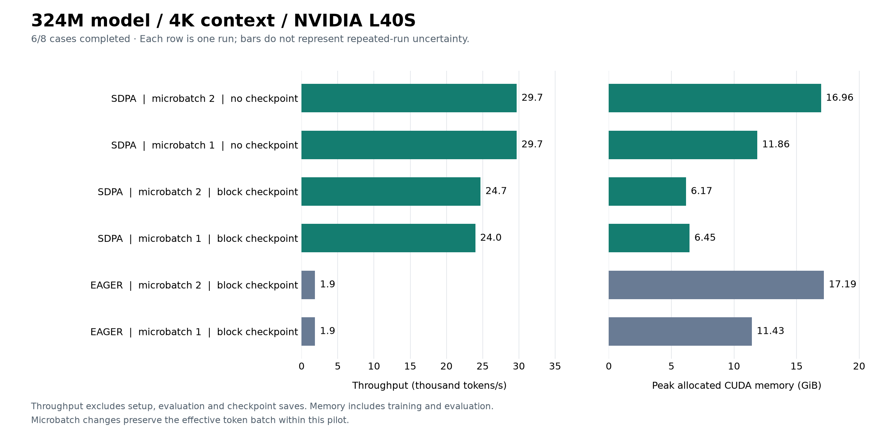

# GPU screen: 324M parameters, 4K context

November 1, 2026. Run `study-20261101T132912Z-324m-4k-screen`.

Six configurations completed; both eager configurations without checkpointing failed with CUDA OOM before their first optimizer update. The full-matrix comparability status is **insufficient**, because two planned cases did not complete. The six completed cases have matching dataset and ordered-batch hashes; their measurements remain useful as a descriptive subset.
This is one invocation per configuration at one seed, not a convergence or quality-equivalence experiment.

## Workload and evidence checks

- Custom 324,092,928-parameter MHA decoder: 24 layers, width 1,024, 16 heads, head dimension 64, feed-forward width 2,752, untied 10,000-token vocabulary/output head, random initialization.
- TinyStories arrays; context 4,096; BF16 autocast with FP32 parameters, optimizer state and loss. Effective batch 2 sequences / 8,192 tokens per update.
- Seed 1337; each completed case trained for 30 updates / 245,760 tokens. Excluding the first five updates leaves 25 timed updates. Validation uses 1 fixed batch(es) of one sequence, totaling 4,096 tokens.
- All 6 completed cases have matching dataset/tokenizer identities and ordered training-batch hashes, expected measured-step counts and finite final losses. This does not assert identical floating-point updates.
- Native CUDA/BF16 preflight passed. Captured test result: **168 passed in 6.41s**. Full returned evidence has no missing files, errors or truncated logs.
- GPU: NVIDIA L40S, reported total memory **50,897,879,040 bytes (47.40 GiB)**. PyTorch 2.11.0; one GPU.



## Measurements

All eight attempted cases are retained below. GiB means 2^30 bytes. Empty metrics indicate no valid completed measurement; they are not zero throughput or zero memory.

| Attention | Checkpoint | Microbatch / accumulation | Status | Median step (ms) | p90 step (ms) | Tokens/s | Allocated (GiB) | Reserved (GiB) | Validation loss |
| --- | --- | ---: | --- | ---: | ---: | ---: | ---: | ---: | ---: |
| SDPA | none | 2 / 1 | completed | 275.79 | 276.07 | 29,706 | 16.96 | 17.87 | 4.813140 |
| SDPA | none | 1 / 2 | completed | 276.09 | 276.46 | 29,695 | 11.86 | 12.58 | 4.814545 |
| SDPA | block | 2 / 1 | completed | 329.77 | 330.53 | 24,725 | 6.17 | 7.84 | 4.820952 |
| SDPA | block | 1 / 2 | completed | 337.63 | 340.65 | 23,992 | 6.45 | 6.98 | 4.822090 |
| EAGER | block | 2 / 1 | completed | 4385.98 | 4386.72 | 1,868 | 17.19 | 17.50 | 4.815112 |
| EAGER | block | 1 / 2 | completed | 4387.22 | 4388.24 | 1,867 | 11.43 | 12.45 | 4.816528 |
| EAGER | none | 2 / 1 | OOM | — | — | — | — | — | — |
| EAGER | none | 1 / 2 | OOM | — | — | — | — | — | — |

The figure shows completed cases only (6/8); OOM outcomes are retained in the table and raw evidence.
Throughput is measured tokens divided by summed timed-step durations, not the reciprocal of the median.
Steps include sampling/transfers, forward/backward, accumulation, checkpoint recomputation, clipping, optimizer work and scalar diagnostics with CUDA synchronization. Imports/setup, evaluation and checkpoint-file saves are excluded from step timing. Memory peaks cover training and evaluation after model setup, including persistent state; allocated memory is not total GPU-process VRAM.

## Observations

1. **OOM is the main feasibility result.** Eager/no-checkpoint microbatch 1 and 2 failed in the forward softmax normalization, before a completed update. Microbatch 1 attempted an additional 1 GiB allocation; microbatch 2 attempted 2 GiB. Their logs report 47.40 GiB total capacity. No finite speedup ratio exists against these failed baselines, and no memory peak was returned for them.
2. With block checkpointing held equal at microbatch 2, SDPA reached 24,725 tokens/s versus eager's 1,868: **13.238x** throughput. Peak allocated memory was 6.17 versus 17.19 GiB. The fastest feasible SDPA policy (no checkpoint, microbatch 2) measured 15.905x the fastest feasible eager policy (block checkpoint, microbatch 2); that comparison changes the checkpoint policy.
3. Uncheckpointed SDPA microbatches 1 and 2 measured 29,695 and 29,706 tokens/s, only 0.035% apart. They should be treated as tied pending repeated invocations. Microbatch 1 used 11.86 GiB versus 16.96 GiB, making it an attractive repeat candidate.
4. SDPA/block/microbatch 2 used 6.17 GiB, 63.6% less than SDPA/no-checkpoint/microbatch 2, with a 19.6% median-step penalty.

**Capacity caveat:** this invocation exposed 50,897,879,040 bytes (47.40 GiB), whereas the other five screening jobs exposed 47,695,921,152 bytes (44.42 GiB), despite all reporting NVIDIA L40S. The cause is not established. Within-invocation policy comparisons share the same exposed capacity; cross-invocation fit limits cannot be treated as measurements on identical available VRAM. The OOM conclusion applies to this recorded invocation/configuration.

Completed-case validation losses span 4.813140–4.822090 (absolute spread 0.00895023). These are numerical sanity checks on a small validation sample. Thirty updates and one seed do not establish convergence, long-run stability, quality equivalence or time to target. Do not compare or pool these losses across model sizes or contexts. The 25 timed steps are not 25 independent experiment repetitions. SDPA uses automatic dispatch; no specific FlashAttention kernel has been verified.

## Time and reproducibility

Remote function time was **395.299 seconds**. Attempted-case subprocess durations sum to **379.800 seconds**. Function timing includes preflight, tests and orchestration, but excludes client upload/image builds; these durations are not a provider bill or proof of dollar savings.

`launch.json`, `launch-summary.json`, `aggregate.json` and `evidence.json` are byte-for-byte copies of `runs/study-20261101-development/324m-4k-screen/`. `input-sha256.json` records their SHA-256 hashes. Evidence includes per-step metrics, case execution results and log tails, resolved configuration, source/package/hardware metadata, preflight and test logs. Model checkpoint binaries remain on Modal Volume `systems-for-llms-results`, under `study-20261101T132912Z-324m-4k-screen/`.

Reproduce the plot with matplotlib installed:

```sh
python scripts/plot_pilot.py results/2026-11-01-324m-4k \
  --title "324M model / 4K context / NVIDIA L40S"
```

See the [six-workload overview](../2026-11-01-scaling-screen/README.md) for scope and candidate-selection limits.
