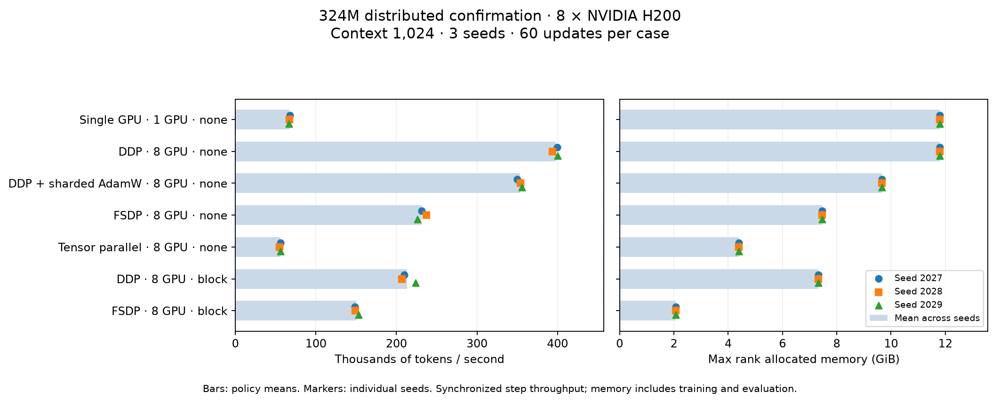

# Distributed training performance study

21 planned cases: 21 completed.

Measured hardware: **8-GPU host, NVIDIA H200**. Every case shares this allocation, including the single-GPU reference.

Repeated-seed confirmation: means, sample standard deviations and ranges describe the recorded seeds. Each comparison uses within-seed ratios; no confidence intervals or population claims are inferred from these repeats.

- Short fixed-global-batch timing runs do not establish convergence, quality equivalence, or research novelty.
- Single-host measurements do not establish multi-node network scaling.
- TP uses all ranks on one microbatch; DDP/FSDP/sharded AdamW partition the global batch. All use the recorded global batch.
- Sharded AdamW shards optimizer state only; its full parameters and gradients remain replicated.
- TP and FSDP initialize a full FP32 model on every GPU before sharding. Training memory savings do not demonstrate initialization of models larger than one GPU can hold; reserved memory can retain the setup allocator cache.

## Findings

All 21 cases completed on an eight-H200 host, following **335 GPU tests passed
with zero skips**. The 324,092,928-parameter model used BF16 autocast, SDPA,
1,024-token context and a fixed global batch of 32 sequences (32,768 tokens per
update). Each policy ran for 60 updates on seeds 2027, 2028 and 2029; the first
five updates are excluded from throughput. Source, data/tokenizer identities,
initial weights, ordered global batches and learning-rate schedules match within
each seed. The training source and frozen plan match the preceding screen.

| Comparison | Confirmed result |
| --- | --- |
| DDP8 vs single GPU | **5.90× median paired speedup**, range 5.88–6.03×; median 73.8% scaling efficiency |
| Owner-sharded AdamW8 vs DDP8 | **87.4% less max-rank optimizer-state bytes**, 18.1% less peak allocated memory; median 11.0% lower throughput |
| FSDP8 vs DDP8, both block checkpointed | **71.7% less peak allocated memory**, 7.326→2.071 GiB; median 29.2% lower throughput |
| TP8 vs single GPU | **62.8% less peak allocated memory**; median 17.2% lower throughput |
| Block checkpointing vs none, DDP8 | **37.9% less peak allocated memory**; median 47.5% lower throughput |
| Block checkpointing vs none, FSDP8 | **72.3% less peak allocated memory**; median 35.8% lower throughput |

The following policy means and sample standard deviations summarize three seeds;
paired ratios above are computed before aggregation. All measured memory peaks
were identical across seeds within each policy.

| Policy | Mean tokens/s ± sample SD | Observed tokens/s range | Peak allocated GiB |
| --- | ---: | ---: | ---: |
| Single GPU, no checkpointing | 67,021 ± 666 | 66,382–67,712 | 11.798 |
| DDP8, no checkpointing | 397,738 ± 3,531 | 393,667–399,956 | 11.802 |
| Owner-sharded AdamW8, no checkpointing | 353,293 ± 3,130 | 349,822–355,903 | 9.662 |
| FSDP8, no checkpointing | 231,534 ± 5,555 | 226,089–237,193 | 7.468 |
| TP8, no checkpointing | 55,733 ± 728 | 54,898–56,235 | 4.383 |
| DDP8, block checkpointing | 213,460 ± 9,035 | 206,839–223,752 | 7.326 |
| FSDP8, block checkpointing | 150,249 ± 2,486 | 148,568–153,104 | 2.071 |

DDP provides the highest throughput for this workload. Sharding and recomputation
save training memory at a measured throughput cost. The combined FSDP-plus-block
configuration uses 82.5% less peak allocated memory than uncheckpointed DDP, but
that comparison changes both sharding and checkpointing. The matched block-policy
comparison isolates the measured FSDP tradeoff. These are observations for this
model, batch, hardware and implementation; they are not general rankings of the
parallelism methods.

## What the repeats establish

All **147 rank artifact sets** contain the expected 60 updates, accounting for
8,820 rank-level training records. Rank-synchronized timing streams and
initialization/data/LR controls passed independent rechecking. The three seeds
share one allocation; the screen used a separate allocation. Neither estimates
variation across a population of GPU hosts.

The short final validation check uses the same eight deterministic windows,
8,192 unique tokens. The largest same-seed difference from uncheckpointed DDP
is **+0.0281 loss** for sharded AdamW at seed 2028. These results establish finite
early training and numerical gates, not equal convergence or equal-quality cost
savings. The FP32 parity tests use smaller correctness configurations.

Checkpointed timing stalls persist and remain in the throughput totals. DDP-block
step-time population coefficients of variation are 54.8%, 41.8% and 35.7%;
FSDP-block values are 55.9%, 46.9% and 40.7%, for seeds 2027/2028/2029. Separate
profiler traces are required before attributing those stalls or TP's slowdown to
a particular operation. Profiling was disabled in these performance runs.

The [earlier screen](../2026-11-01-distributed/README.md) additionally measures
1/2/4/8-rank scaling, 4K context, accumulation synchronization and DDP buckets.
Those ablations retain their one-screening-seed qualification. The confirmation
has no block-checkpointed single-GPU baseline; corresponding strong-scaling
ratios are deliberately absent.

## Measurement and comparisons

Each optimizer step follows an inter-rank barrier and device synchronization. Reported time is the maximum rank time, including data, backward synchronization, clipping, update and loss reduction; it excludes the timing-max reduction, evaluation, setup and checkpoint writes. This measures synchronized steps, not uninterrupted end-to-end training throughput.

Speedup is measured throughput divided by a completed single-GPU baseline with matching model, context, seed, precision, checkpointing, global batch, update horizon and warmup. Model/source/data/initialization and batch/LR streams must also match. Efficiency is speedup divided by participating GPUs. Missing or mismatched baselines have no ratio.

Peak CUDA allocated/reserved memory is the maximum across ranks and includes training and evaluation after model/wrapper setup, excluding final state export. Optimizer bytes count actual optimizer tensors, including any CPU step counters; they are not all GPU-resident bytes.

## Measured policies

Canonical 1K cases use microbatch 4; 4K cases use microbatch 1. Both use final-microbatch synchronization and a 25 MiB DDP bucket setting. Other microbatch, synchronization and bucket experiments remain in the full table.

## Paired seed comparisons

Each ratio is computed within one matched seed before aggregation. SD is the sample standard deviation across seeds; ranges retain all repeats. No confidence interval is claimed. Memory reductions are 1 minus the numerator/denominator ratio, so a negative value means memory increased. Validation-loss differences describe this short horizon and do not establish equal convergence.

| Numerator / denominator | Checkpoint policies | GPU counts | Pairs | Throughput ratio mean ± SD | Throughput median [min, max] | Allocated memory reduction | Optimizer state reduction |
|---|---|---|---:|---:|---:|---:|---:|
| ddp / ddp | block / none | 8 / 8 | 3 | 0.537 ± 0.020 | 0.525 [0.525, 0.559] | 37.92% | 0.00% |
| ddp / single | none / none | 8 / 1 | 3 | 5.935 ± 0.079 | 5.901 [5.878, 6.025] | -0.03% | 0.00% |
| fsdp / fsdp | block / none | 8 / 8 | 3 | 0.649 ± 0.025 | 0.642 [0.628, 0.677] | 72.26% | 0.00% |
| fsdp / ddp | block / block | 8 / 8 | 3 | 0.704 ± 0.019 | 0.708 [0.684, 0.721] | 71.73% | 87.50% |
| fsdp / ddp | none / none | 8 / 8 | 3 | 0.582 ± 0.019 | 0.579 [0.565, 0.603] | 36.73% | 87.50% |
| tp / single | none / none | 8 / 1 | 3 | 0.832 ± 0.014 | 0.828 [0.820, 0.847] | 62.85% | 81.96% |
| zero1 / ddp | none / none | 8 / 8 | 3 | 0.888 ± 0.012 | 0.890 [0.875, 0.900] | 18.13% | 87.42% |

The machine-readable summary retains every paired seed ratio, validation-loss difference, policy mean, median, sample SD and range. Checkpoint-treatment pairs allow only the activation-checkpointing config field to differ; all other model/config, source, data, initialization and batch/LR provenance must match.

## Every planned case

GPU-s/update is active measured GPU time, not billed allocation time. Dashes indicate unmeasured or unavailable values.

| Case | Status | tokens/s | Speedup | Efficiency | Max allocated GiB | Max reserved GiB | Max optimizer GiB | Sum optimizer GiB | GPU-s/update | Valid loss |
|---|---|---:|---:|---:|---:|---:|---:|---:|---:|---:|
| 324m-s1024-ddp-w8-mb4-block-last-b25-bf16-seed2029 | completed | 223,752 | — | — | 7.33 | 7.90 | 2.41 | 19.32 | 1.172 | 3.7675 |
| 324m-s1024-zero1-w8-mb4-none-last-b25-bf16-seed2027 | completed | 349,822 | 5.17 | 64.6% | 9.66 | 10.26 | 0.30 | 2.41 | 0.749 | 3.7921 |
| 324m-s1024-fsdp-w8-mb4-none-last-b25-bf16-seed2028 | completed | 237,193 | 3.54 | 44.3% | 7.47 | 8.49 | 0.30 | 2.41 | 1.105 | 3.7782 |
| 324m-s1024-zero1-w8-mb4-none-last-b25-bf16-seed2028 | completed | 354,155 | 5.29 | 66.1% | 9.66 | 10.26 | 0.30 | 2.41 | 0.740 | 3.8061 |
| 324m-s1024-ddp-w8-mb4-block-last-b25-bf16-seed2028 | completed | 206,839 | — | — | 7.33 | 7.90 | 2.41 | 19.32 | 1.267 | 3.7784 |
| 324m-s1024-fsdp-w8-mb4-none-last-b25-bf16-seed2027 | completed | 231,319 | 3.42 | 42.7% | 7.47 | 8.49 | 0.30 | 2.41 | 1.133 | 3.7920 |
| 324m-s1024-tp-w8-mb4-none-last-b25-bf16-seed2029 | completed | 56,235 | 0.85 | 10.6% | 4.38 | 4.79 | 0.44 | 3.49 | 4.662 | 3.7656 |
| 324m-s1024-ddp-w8-mb4-none-last-b25-bf16-seed2027 | completed | 399,591 | 5.90 | 73.8% | 11.80 | 12.70 | 2.41 | 19.32 | 0.656 | 3.7919 |
| 324m-s1024-ddp-w8-mb4-none-last-b25-bf16-seed2029 | completed | 399,956 | 6.03 | 75.3% | 11.80 | 12.70 | 2.41 | 19.32 | 0.655 | 3.7732 |
| 324m-s1024-ddp-w8-mb4-none-last-b25-bf16-seed2028 | completed | 393,667 | 5.88 | 73.5% | 11.80 | 12.70 | 2.41 | 19.32 | 0.666 | 3.7780 |
| 324m-s1024-single-w1-mb4-none-last-b25-bf16-seed2029 | completed | 66,382 | 1.00 | 100.0% | 11.80 | 12.52 | 2.41 | 2.41 | 0.494 | 3.7709 |
| 324m-s1024-fsdp-w8-mb4-block-last-b25-bf16-seed2029 | completed | 153,104 | — | — | 2.07 | 2.67 | 0.30 | 2.41 | 1.712 | 3.7765 |
| 324m-s1024-zero1-w8-mb4-none-last-b25-bf16-seed2029 | completed | 355,903 | 5.36 | 67.0% | 9.66 | 10.26 | 0.30 | 2.41 | 0.737 | 3.7759 |
| 324m-s1024-single-w1-mb4-none-last-b25-bf16-seed2028 | completed | 66,970 | 1.00 | 100.0% | 11.80 | 12.52 | 2.41 | 2.41 | 0.489 | 3.7781 |
| 324m-s1024-fsdp-w8-mb4-block-last-b25-bf16-seed2028 | completed | 149,076 | — | — | 2.07 | 2.67 | 0.30 | 2.41 | 1.758 | 3.7782 |
| 324m-s1024-ddp-w8-mb4-block-last-b25-bf16-seed2027 | completed | 209,788 | — | — | 7.33 | 7.90 | 2.41 | 19.32 | 1.250 | 3.7920 |
| 324m-s1024-tp-w8-mb4-none-last-b25-bf16-seed2028 | completed | 54,898 | 0.82 | 10.2% | 4.38 | 4.79 | 0.44 | 3.49 | 4.775 | 3.7946 |
| 324m-s1024-tp-w8-mb4-none-last-b25-bf16-seed2027 | completed | 56,067 | 0.83 | 10.4% | 4.38 | 4.79 | 0.44 | 3.49 | 4.676 | 3.7916 |
| 324m-s1024-fsdp-w8-mb4-block-last-b25-bf16-seed2027 | completed | 148,568 | — | — | 2.07 | 2.67 | 0.30 | 2.41 | 1.764 | 3.7927 |
| 324m-s1024-fsdp-w8-mb4-none-last-b25-bf16-seed2029 | completed | 226,089 | 3.41 | 42.6% | 7.47 | 8.49 | 0.30 | 2.41 | 1.159 | 3.7752 |
| 324m-s1024-single-w1-mb4-none-last-b25-bf16-seed2027 | completed | 67,712 | 1.00 | 100.0% | 11.80 | 12.52 | 2.41 | 2.41 | 0.484 | 3.7921 |

## Allocation and cost

Active GPU-seconds per update = participating GPUs × measured training seconds / measured updates. All allocated GPUs are billed even during a one-GPU baseline. Allocated GPU-seconds for subprocesses include process startup and evaluation, but not all launch overhead. Function-time dollar estimates use the launch's recorded requested-resource rate; they are not invoices and exclude image builds, startup, excess CPU/RAM, storage/egress and other apps.

The measured host allocated **8 GPUs** for every case.

| Stage | Status | Function seconds | Allocated GPUs | Requested-resource estimate USD |
|---|---|---:|---:|---:|
| confirmation | completed | 988.25 | 8 | 10.3171 |

Sum of available function-time estimates: $10.3171. Every listed stage has a recorded rate and function time.

## Hardware and correctness evidence

PyTorch: `2.11.0+cu130`; CUDA: `13.0`.

| GPU index | Name | UUID | Memory GiB |
|---:|---|---|---:|
| 0 | NVIDIA H200 | `dbe791e3-3023-dc56-3851-069c7fc8b38e` | 139.79 |
| 1 | NVIDIA H200 | `eb3fb61a-f22d-93c5-58d5-98c318667546` | 139.79 |
| 2 | NVIDIA H200 | `4be8b365-430b-0c32-2b59-c2b5d39bc399` | 139.79 |
| 3 | NVIDIA H200 | `15a9e8b2-fccd-ff72-e5a1-62761f0f303d` | 139.79 |
| 4 | NVIDIA H200 | `52e1d28f-3c77-53a3-d294-afd8400273f1` | 139.79 |
| 5 | NVIDIA H200 | `72608512-e8ab-fe7a-e06f-99f64603b483` | 139.79 |
| 6 | NVIDIA H200 | `afabf2d4-2fbe-5ffc-d8e6-37c4782940ac` | 139.79 |
| 7 | NVIDIA H200 | `965839a0-ae78-3e3f-d126-dbc0cd9b83b4` | 139.79 |

Packed stage correctness gate: tests=335, passed=335, failures=0, errors=0, skipped=0.

## Reproducibility

Plan SHA256: `b50c98342f3499b3bc4b502b626404a11b9f0917ece03d1ac68f898cc6c910aa`.

Training source SHA256: `69bab1d43100179dddf5da35a8687b6c1c521231cb764e8d13f650af3556336c`.

[Machine-readable summary](summary.json) contains per-file artifact source hashes, rank memory measurements, baseline choices, and cost-rate provenance. [Raw aggregate](inputs/confirmation/aggregate.json) and [packed evidence](inputs/confirmation/evidence.json) preserve the original JSON, full metric streams, and bounded logs. All copied inputs have SHA256 checksums in `summary.json`. These files can be reviewed without the original machine or cloud volume.

## Evidence limitations

- 324m-s1024-ddp-w8-mb4-block-last-b25-bf16-seed2029: no matched completed single-GPU baseline; ratios omitted
- 324m-s1024-ddp-w8-mb4-block-last-b25-bf16-seed2028: no matched completed single-GPU baseline; ratios omitted
- 324m-s1024-fsdp-w8-mb4-block-last-b25-bf16-seed2029: no matched completed single-GPU baseline; ratios omitted
- 324m-s1024-fsdp-w8-mb4-block-last-b25-bf16-seed2028: no matched completed single-GPU baseline; ratios omitted
- 324m-s1024-ddp-w8-mb4-block-last-b25-bf16-seed2027: no matched completed single-GPU baseline; ratios omitted
- 324m-s1024-fsdp-w8-mb4-block-last-b25-bf16-seed2027: no matched completed single-GPU baseline; ratios omitted
- Hardware diagnostic: nvidia-smi topo -m: unavailable
- Physical GPU interconnect topology was not reported; peer-access capability alone does not identify link type or bandwidth.
