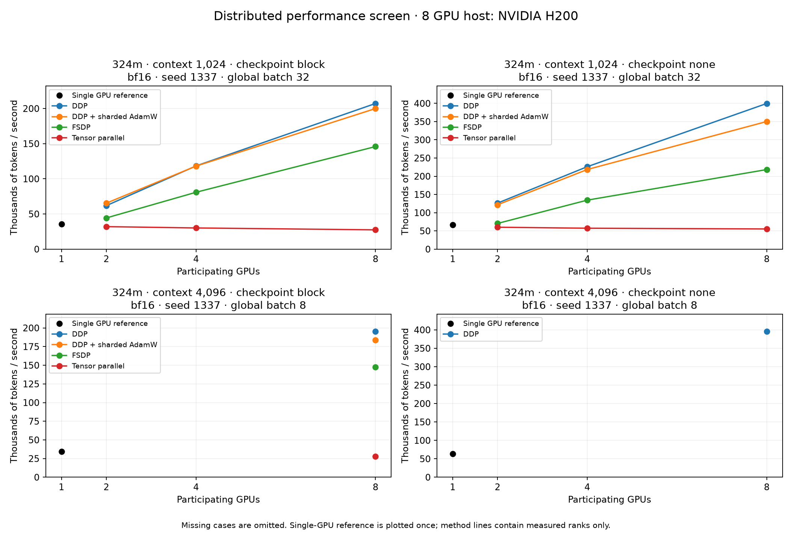
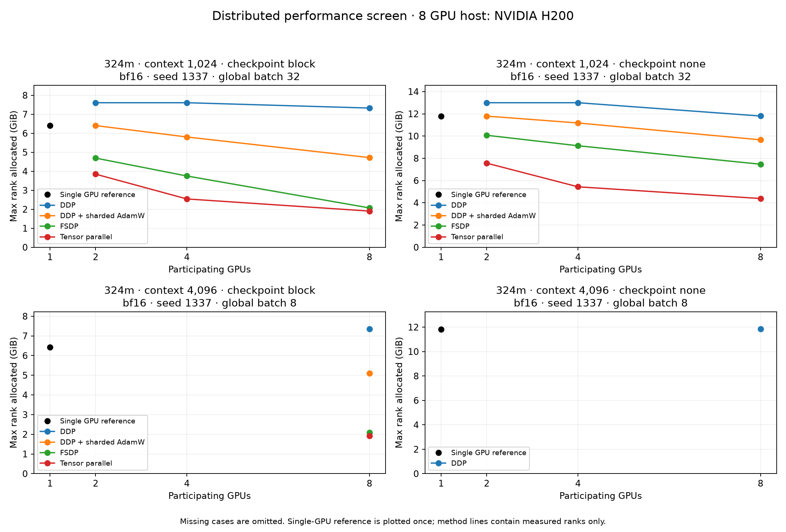

# Distributed training performance study

38 planned cases: 38 completed.

Measured hardware: **8-GPU host, NVIDIA H200**. One-, two-, four- and eight-rank cases share this allocation.

This report preserves the one-seed performance screen. The subsequent
[three-seed confirmation](../2026-11-01-distributed-confirmation/README.md)
completed all 21 selected cases and is reported separately.

- Short fixed-global-batch timing runs do not establish convergence, quality equivalence, or research novelty.
- Single-host measurements do not establish multi-node network scaling.
- TP uses all ranks on one microbatch; DDP/FSDP/sharded AdamW partition the global batch. All use the recorded global batch.
- Sharded AdamW shards optimizer state only; its full parameters and gradients remain replicated.
- TP and FSDP initialize a full FP32 model on every GPU before sharding. Training memory savings do not demonstrate initialization of models larger than one GPU can hold; reserved memory can retain the setup allocator cache.

## Findings from the completed screen

The 324,092,928-parameter Transformer ran with BF16 autocast and SDPA across 1/2/4/8 participating GPUs on one eight-H200 host. Each case completed 60 optimizer updates (32,768 tokens/update); throughput excludes the first five timing warmup updates. All 38 scale cases and 10 separate smoke cases completed. The full test suite passed 333 tests with zero skips on both the smoke and scale hosts. The smoke host used two H100 80GB GPUs.

| Comparison | Observation | Interpretation |
|---|---|---|
| DDP, 1→8 GPUs, 1K context | 66,805→399,696 tokens/s; **5.98× speedup, 74.8% efficiency** | Strong scaling at fixed global batch 32 |
| DDP, 1→8 GPUs, 4K context | 63,273→395,309 tokens/s; **6.25× speedup, 78.1% efficiency** | Separate fixed-global-batch-8 comparison |
| Sharded AdamW vs DDP, eight GPUs, 1K | **87.4% less max-rank optimizer-state bytes**; 18.1% less peak allocated memory; 12.4% lower throughput | Optimizer-state storage decreases at a measurable throughput cost |
| FSDP vs DDP, both block checkpointed, eight GPUs, 1K | **7.326→2.071 GiB peak allocated memory (−71.7%)**; 29.6% lower throughput | Matched checkpoint policies isolate the FSDP tradeoff |
| Tensor parallelism, eight GPUs vs single GPU, 1K, no checkpointing | **62.8% less peak allocated memory**, but 55,339 vs 66,805 tokens/s (−17.2%) | Tensor parallelism did not improve speed for this model and implementation |
| DDP accumulation synchronization, eight GPUs, microbatch 1 | Synchronizing after accumulation: **122,574 vs 110,711 tokens/s (+10.7%)** | Same global batch; both policies perform four microbatches/update |

These are initial screen measurements, not independently confirmed headline improvements. The 100 MiB versus 25 MiB bucket difference was only 0.87%; there is insufficient evidence to call that a benefit. Block-checkpointed DDP8 and FSDP8 had step-time coefficients of variation of 54.9% and 65.5%, respectively. The report keeps those stalls in the throughput calculation. Profiler traces are needed before attributing them, or TP's slowdown, to a specific bottleneck.

All 196 scale rank-artifact sets contain the expected updates and finite training losses and gradient norms. Initialization, training source, and ordered batch/LR streams match within each context group. The small final-loss differences after 60 updates establish short-run stability only. No convergence-equivalence claim is made.

The launch requested H100:8 but preflight and rank metadata identify H200s. [Modal documents automatic H100→H200 upgrades at the requested GPU price](https://modal.com/docs/guide/gpu). Hardware labels follow observations; cost estimates follow the recorded request. The topology query was unavailable, so this report does not claim a measured interconnect type or bandwidth.

## Confirmation selected before launch

A focused 21-case confirmation repeats seven 1K policies on seeds 2027, 2028 and 2029: single GPU, DDP8, sharded AdamW8, FSDP8 and TP8 without checkpointing, plus DDP8 and FSDP8 with block checkpointing. It keeps 60 updates, five timing warmup updates, global batch 32 and microbatch 4, and explicitly requests H200:8. It does not repeat the 4K or communication ablations, which remain screen-only findings.

Report every repeat and the median and range of paired per-seed DDP speedups, optimizer-state reductions, FSDP-versus-DDP memory/throughput ratios, and TP-versus-single ratios. Do not treat individual optimizer steps as independent experiments or silently discard stalls. Check source, model, data and batch controls before pooling runs; hardware identity must be reported again. There is no checkpointed single-GPU confirmation baseline, so block-policy repeats establish the DDP/FSDP tradeoff rather than a new block-checkpointed strong-scaling ratio.

The [frozen confirmation plan](confirmation-plan.json) has SHA256
`b50c98342f3499b3bc4b502b626404a11b9f0917ece03d1ac68f898cc6c910aa`.
The successful retry, `distributed-20261101T230037Z-e05d5479`, completed all
21 cases on eight H200s in 988.25 seconds and passed 335 GPU tests with zero
skips. Its training-source hash matches this screen. The
[confirmation report](../2026-11-01-distributed-confirmation/README.md) records
per-seed measurements, paired medians/ranges and portable raw evidence.

The central findings repeated: median paired DDP speedup 5.90× (5.88–6.03×);
87.4% less optimizer-state bytes with sharded AdamW; 71.7% less peak allocated
memory for checkpointed FSDP versus checkpointed DDP; and median 17.2% lower
throughput for TP8 versus single GPU. The 4K, bucket and synchronization
ablations in this screen were not repeated. The earlier interrupted confirmation
returned no local case results and contributes no measurements to either report.

## Measurement and comparisons

Each optimizer step follows an inter-rank barrier and device synchronization. Reported time is the maximum rank time, including data, backward synchronization, clipping, update and loss reduction; it excludes the timing-max reduction, evaluation, setup and checkpoint writes. This measures synchronized steps, not uninterrupted end-to-end training throughput.

Speedup is measured throughput divided by a completed single-GPU baseline with matching model, context, seed, precision, checkpointing, global batch, update horizon and warmup. Model/source/data/initialization and batch/LR streams must also match. Efficiency is speedup divided by participating GPUs. Missing or mismatched baselines have no ratio.

Peak CUDA allocated/reserved memory is the maximum across ranks and includes training and evaluation after model/wrapper setup, excluding final state export. Optimizer bytes count actual optimizer tensors, including any CPU step counters; they are not all GPU-resident bytes.

## Canonical scaling sweeps

1K sweeps use microbatch 4; 4K sweeps use microbatch 1. Both use final-microbatch synchronization and a 25 MiB DDP bucket setting. Other microbatch, synchronization and bucket experiments remain in the full table. Context lengths and checkpoint policies use separate panels.

## Every planned case

GPU-s/update is active measured GPU time, not billed allocation time. Dashes indicate unmeasured or unavailable values.

| Case | Status | tokens/s | Speedup | Efficiency | Max allocated GiB | Max reserved GiB | Max optimizer GiB | Sum optimizer GiB | GPU-s/update | Valid loss |
|---|---|---:|---:|---:|---:|---:|---:|---:|---:|---:|
| 324m-s1024-fsdp-w8-mb4-block-last-b25-bf16-seed1337 | completed | 145,899 | 4.10 | 51.2% | 2.07 | 2.67 | 0.30 | 2.41 | 1.797 | 3.8156 |
| 324m-s1024-ddp-w8-mb1-none-last-b25-bf16-seed1337 | completed | 122,574 | 1.83 | 22.9% | 8.27 | 8.77 | 2.41 | 19.32 | 2.139 | 3.8158 |
| 324m-s1024-fsdp-w4-mb4-block-last-b25-bf16-seed1337 | completed | 80,889 | 2.27 | 56.8% | 3.75 | 4.65 | 0.60 | 2.41 | 1.620 | 3.8154 |
| 324m-s4096-zero1-w8-mb1-block-last-b25-bf16-seed1337 | completed | 183,612 | 5.36 | 67.0% | 5.10 | 5.45 | 0.30 | 2.41 | 1.428 | 3.9176 |
| 324m-s1024-zero1-w8-mb4-none-last-b25-bf16-seed1337 | completed | 350,198 | 5.24 | 65.5% | 9.66 | 10.26 | 0.30 | 2.41 | 0.749 | 3.8163 |
| 324m-s4096-single-w1-mb1-none-last-b25-bf16-seed1337 | completed | 63,273 | 1.00 | 100.0% | 11.83 | 12.55 | 2.41 | 2.41 | 0.518 | 3.9175 |
| 324m-s1024-fsdp-w2-mb4-none-last-b25-bf16-seed1337 | completed | 70,471 | 1.05 | 52.7% | 10.07 | 11.38 | 1.21 | 2.41 | 0.930 | 3.8157 |
| 324m-s1024-ddp-w8-mb4-block-last-b25-bf16-seed1337 | completed | 207,187 | 5.82 | 72.8% | 7.33 | 7.90 | 2.41 | 19.32 | 1.265 | 3.8155 |
| 324m-s1024-ddp-w2-mb4-block-last-b25-bf16-seed1337 | completed | 61,835 | 1.74 | 86.9% | 7.61 | 8.03 | 2.41 | 4.83 | 1.060 | 3.8149 |
| 324m-s1024-ddp-w2-mb4-none-last-b25-bf16-seed1337 | completed | 126,224 | 1.89 | 94.5% | 13.00 | 13.69 | 2.41 | 4.83 | 0.519 | 3.8159 |
| 324m-s1024-zero1-w8-mb4-block-last-b25-bf16-seed1337 | completed | 199,992 | 5.62 | 70.2% | 4.72 | 4.93 | 0.30 | 2.41 | 1.311 | 3.8150 |
| 324m-s1024-fsdp-w4-mb4-none-last-b25-bf16-seed1337 | completed | 134,447 | 2.01 | 50.3% | 9.13 | 10.28 | 0.60 | 2.41 | 0.975 | 3.8163 |
| 324m-s1024-zero1-w2-mb4-none-last-b25-bf16-seed1337 | completed | 121,692 | 1.82 | 91.1% | 11.79 | 12.54 | 1.21 | 2.41 | 0.539 | 3.8157 |
| 324m-s1024-ddp-w8-mb4-none-last-b25-bf16-seed1337 | completed | 399,696 | 5.98 | 74.8% | 11.80 | 12.70 | 2.41 | 19.32 | 0.656 | 3.8162 |
| 324m-s1024-fsdp-w2-mb4-block-last-b25-bf16-seed1337 | completed | 44,347 | 1.25 | 62.3% | 4.69 | 5.77 | 1.21 | 2.41 | 1.478 | 3.8123 |
| 324m-s1024-naive-w8-mb4-none-last-b25-bf16-seed1337 | completed | 365,754 | 5.47 | 68.4% | 10.60 | 11.59 | 2.41 | 19.32 | 0.717 | 3.8155 |
| 324m-s4096-ddp-w8-mb1-none-last-b25-bf16-seed1337 | completed | 395,309 | 6.25 | 78.1% | 11.84 | 12.74 | 2.41 | 19.32 | 0.663 | 3.9173 |
| 324m-s1024-zero1-w4-mb4-none-last-b25-bf16-seed1337 | completed | 218,501 | 3.27 | 81.8% | 11.18 | 11.84 | 0.61 | 2.41 | 0.600 | 3.8153 |
| 324m-s4096-fsdp-w8-mb1-block-last-b25-bf16-seed1337 | completed | 147,702 | 4.31 | 53.9% | 2.09 | 2.69 | 0.30 | 2.41 | 1.775 | 3.9175 |
| 324m-s1024-zero1-w4-mb4-block-last-b25-bf16-seed1337 | completed | 118,113 | 3.32 | 83.0% | 5.80 | 6.10 | 0.61 | 2.41 | 1.110 | 3.8168 |
| 324m-s1024-ddp-w8-mb1-none-last-b100-bf16-seed1337 | completed | 123,639 | 1.85 | 23.1% | 8.28 | 8.75 | 2.41 | 19.32 | 2.120 | 3.8158 |
| 324m-s1024-ddp-w8-mb1-none-every-b25-bf16-seed1337 | completed | 110,711 | 1.66 | 20.7% | 8.28 | 8.73 | 2.41 | 19.32 | 2.368 | 3.8167 |
| 324m-s1024-tp-w8-mb4-block-last-b25-bf16-seed1337 | completed | 27,414 | 0.77 | 9.6% | 1.90 | 2.54 | 0.44 | 3.49 | 9.563 | 3.8152 |
| 324m-s1024-single-w1-mb4-block-last-b25-bf16-seed1337 | completed | 35,587 | 1.00 | 100.0% | 6.41 | 7.01 | 2.41 | 2.41 | 0.921 | 3.8155 |
| 324m-s1024-tp-w4-mb4-block-last-b25-bf16-seed1337 | completed | 30,117 | 0.85 | 21.2% | 2.54 | 2.91 | 0.72 | 2.87 | 4.352 | 3.8163 |
| 324m-s1024-ddp-w4-mb4-none-last-b25-bf16-seed1337 | completed | 226,220 | 3.39 | 84.7% | 13.00 | 13.69 | 2.41 | 9.66 | 0.579 | 3.8157 |
| 324m-s1024-tp-w2-mb4-none-last-b25-bf16-seed1337 | completed | 60,115 | 0.90 | 45.0% | 7.56 | 8.02 | 1.28 | 2.57 | 1.090 | 3.8156 |
| 324m-s1024-zero1-w2-mb4-block-last-b25-bf16-seed1337 | completed | 65,392 | 1.84 | 91.9% | 6.40 | 6.87 | 1.21 | 2.41 | 1.002 | 3.8157 |
| 324m-s1024-ddp-w4-mb4-block-last-b25-bf16-seed1337 | completed | 118,339 | 3.33 | 83.1% | 7.61 | 8.03 | 2.41 | 9.66 | 1.108 | 3.8158 |
| 324m-s4096-tp-w8-mb1-block-last-b25-bf16-seed1337 | completed | 27,775 | 0.81 | 10.1% | 1.92 | 2.55 | 0.44 | 3.49 | 9.438 | 3.9174 |
| 324m-s4096-single-w1-mb1-block-last-b25-bf16-seed1337 | completed | 34,239 | 1.00 | 100.0% | 6.42 | 7.03 | 2.41 | 2.41 | 0.957 | 3.9176 |
| 324m-s1024-ddp-w8-mb1-none-last-b1-bf16-seed1337 | completed | 116,887 | 1.75 | 21.9% | 8.28 | 8.81 | 2.41 | 19.32 | 2.243 | 3.8158 |
| 324m-s1024-tp-w4-mb4-none-last-b25-bf16-seed1337 | completed | 57,363 | 0.86 | 21.5% | 5.44 | 5.84 | 0.72 | 2.87 | 2.285 | 3.8163 |
| 324m-s1024-tp-w2-mb4-block-last-b25-bf16-seed1337 | completed | 31,988 | 0.90 | 44.9% | 3.85 | 4.17 | 1.28 | 2.57 | 2.049 | 3.8149 |
| 324m-s1024-fsdp-w8-mb4-none-last-b25-bf16-seed1337 | completed | 218,314 | 3.27 | 40.8% | 7.47 | 8.49 | 0.30 | 2.41 | 1.201 | 3.8147 |
| 324m-s1024-tp-w8-mb4-none-last-b25-bf16-seed1337 | completed | 55,339 | 0.83 | 10.4% | 4.38 | 4.79 | 0.44 | 3.49 | 4.737 | 3.8152 |
| 324m-s4096-ddp-w8-mb1-block-last-b25-bf16-seed1337 | completed | 195,089 | 5.70 | 71.2% | 7.34 | 7.92 | 2.41 | 19.32 | 1.344 | 3.9176 |
| 324m-s1024-single-w1-mb4-none-last-b25-bf16-seed1337 | completed | 66,805 | 1.00 | 100.0% | 11.80 | 12.52 | 2.41 | 2.41 | 0.491 | 3.8146 |

## Allocation and cost

Active GPU-seconds per update = participating GPUs × measured training seconds / measured updates. All allocated GPUs are billed even during a one-GPU baseline. Allocated GPU-seconds for subprocesses include process startup and evaluation, but not all launch overhead. Function-time dollar estimates use the launch's recorded requested-resource rate; they are not invoices and exclude image builds, startup, excess CPU/RAM, storage/egress and other apps.

The scale host allocated **8 GPUs** for every case.

| Stage | Status | Function seconds | Allocated GPUs | Requested-resource estimate USD |
|---|---|---:|---:|---:|
| scale | completed | 1,879.02 | 8 | 17.1511 |
| smoke | completed | 330.01 | 2 | 0.7821 |

Sum of available function-time estimates: $17.9332. Every listed stage has a recorded rate and function time.

## Hardware and correctness evidence

PyTorch: `2.11.0+cu130`; CUDA: `13.0`.

| GPU index | Name | UUID | Memory GiB |
|---:|---|---|---:|
| 0 | NVIDIA H200 | `eedbd502-9413-1422-7e37-f6f43f6558a1` | 139.79 |
| 1 | NVIDIA H200 | `3793176b-47c5-eb84-9f26-57bac1edcb70` | 139.79 |
| 2 | NVIDIA H200 | `4799f869-0680-f99e-34e0-79032fadfe2e` | 139.79 |
| 3 | NVIDIA H200 | `79af3907-5ccf-4faf-68a2-074ad6dd2241` | 139.79 |
| 4 | NVIDIA H200 | `8aa43195-5864-c7fd-eaae-d76855f477d3` | 139.79 |
| 5 | NVIDIA H200 | `6e332533-7212-3f21-9701-21c7292ad2cc` | 139.79 |
| 6 | NVIDIA H200 | `99a8a4df-04f8-ea9b-37cb-6818c0cbb973` | 139.79 |
| 7 | NVIDIA H200 | `f4defbbb-74c8-c9a7-ac15-64731ceb0b51` | 139.79 |

Packed scale correctness gate: tests=333, passed=333, failures=0, errors=0, skipped=0.

## Reproducibility

Plan SHA256: `96d0f72c8e49633ff48a2c4d78a72204b2ef22cf842faaba3089c3d2c2abd518`.

Training source SHA256: `69bab1d43100179dddf5da35a8687b6c1c521231cb764e8d13f650af3556336c`.

[Machine-readable summary](summary.json) contains per-file artifact source hashes, rank memory measurements, baseline choices, and cost-rate provenance. [Raw aggregate](inputs/scale/aggregate.json) and [packed evidence](inputs/scale/evidence.json) preserve the original JSON, full metric streams, and bounded logs. All copied inputs have SHA256 checksums in `summary.json`. These files can be reviewed without the original machine or cloud volume.

## Evidence limitations

- Hardware diagnostic: nvidia-smi topo -m: unavailable
- Physical GPU interconnect topology was not reported; peer-access capability alone does not identify link type or bandwidth.
